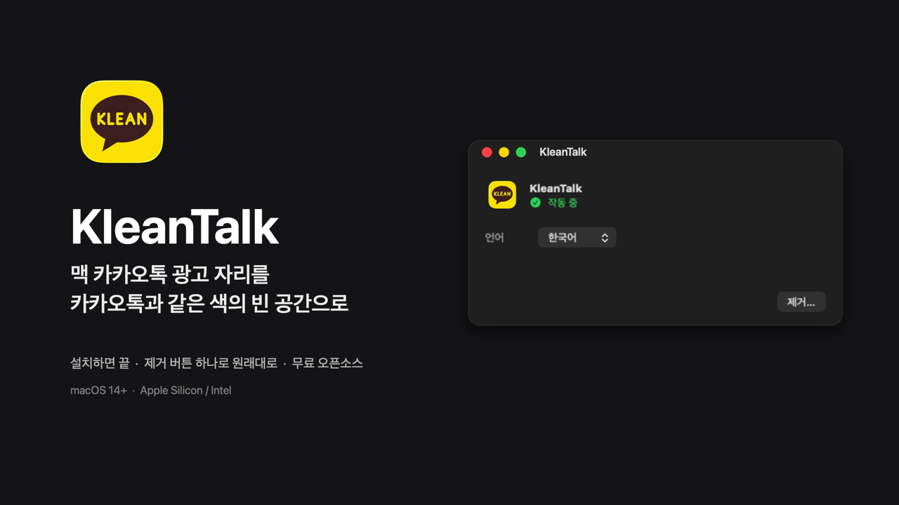
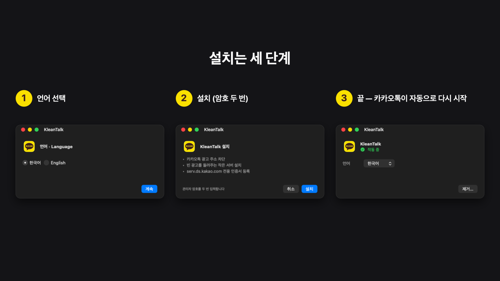
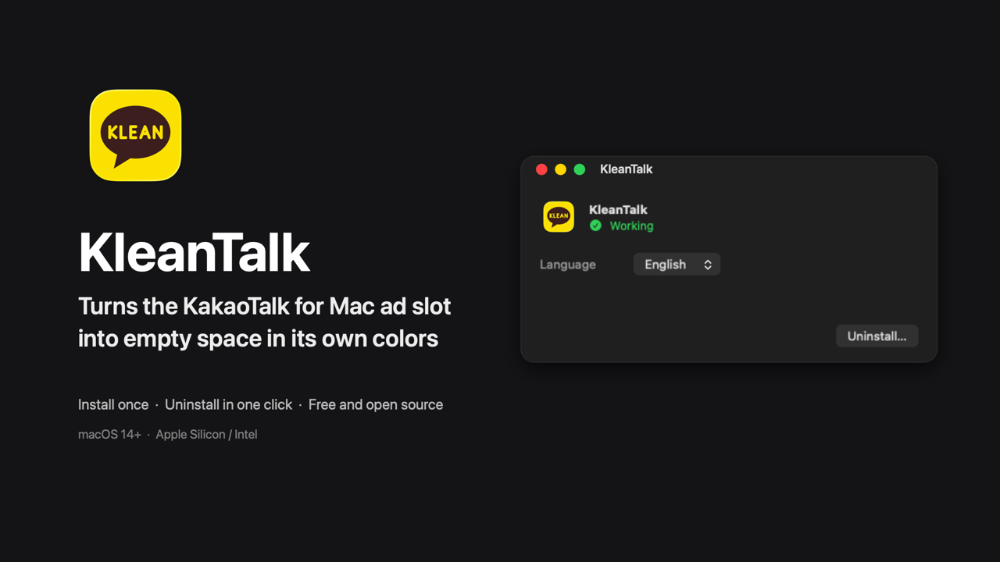

# KleanTalk

맥용 카카오톡의 광고 자리를 **카카오톡과 같은 색의 빈 공간**으로 바꾸는 macOS 앱입니다.
카카오톡 앱 파일을 고치거나 다시 서명하지 않고, 대화 내용과 설정에도 손대지 않습니다.





> 카카오와 관계없는 비공식 개인 프로젝트입니다. 사용에 따른 책임은 사용자에게 있습니다.
> 카카오톡 이용약관과 맞지 않을 수 있으니 확인하고 사용하세요.

## 어떻게 동작하나요

맥 카카오톡은 광고를 받지 못하면 그 자리에 카카오 홍보 배너를 대신 띄웁니다.
그래서 광고 주소를 막기만 해서는 광고 자리가 비지 않습니다. KleanTalk은 이렇게 합니다.

1. `/etc/hosts`에서 카카오 광고 주소(`display.ad.daum.net`, `analytics.ad.daum.net`)를 막습니다.
2. 카카오톡이 광고를 받아 오는 주소(`serv.ds.kakao.com`)는 이 맥 안의 작은 서버로 돌립니다.
3. 그 서버는 진짜 광고 서버와 같은 형식으로 **빈 광고**를 돌려줍니다.
   - 광고 내용은 카카오톡 창과 같은 색으로 칠한 빈 화면입니다.
   - 카카오톡은 이를 정상 광고로 받아들입니다. 그래서 홍보 배너가 나오지 않고, 광고 자리는 빈 공간으로 보입니다.
4. 진짜 광고 서버에는 연결하지 않으므로 광고 이미지, 추적 코드, 노출 집계도 오가지 않습니다.

## 설치

1. [KleanTalk.dmg 받기](https://github.com/showmeyourway-sketch/KleanTalk/releases/latest/download/KleanTalk.dmg) 후 `KleanTalk.app`을 응용 프로그램 폴더로 옮깁니다.
2. 앱을 엽니다. 처음 열 때 *"Apple은 악성 코드가 없는지 확인할 수 없습니다"* 경고가 뜨면 다음과 같이 합니다.
   - 이 앱은 Apple 공증을 받지 않아 이 경고가 뜹니다.
   - **시스템 설정 → 개인정보 보호 및 보안**의 아래쪽에서 **그래도 열기**를 누르세요.
3. 언어(한국어 / English)를 고르고 **설치**를 누릅니다. 암호를 **두 번** 묻습니다.
   - 첫 번째: 관리자 권한으로 서버와 hosts를 설치합니다.
   - 두 번째: macOS가 인증서 신뢰 설정을 확인합니다.
4. 설치가 끝나면 카카오톡이 자동으로 다시 시작되고, 광고 자리가 빈 공간으로 바뀝니다.

설치 뒤에는 따로 켤 필요가 없습니다. KleanTalk은 로그인할 때 창 없이 실행돼 설정이 풀리지 않았는지 가끔 확인합니다.
macOS 업데이트로 hosts가 초기화되는 경우 등에 확인합니다. 문제가 생기면 창을 띄워 **다시 설치**를 권합니다.

## 제거

KleanTalk을 열고 **제거…**를 누릅니다. 다음을 모두 되돌리고 앱을 휴지통으로 옮깁니다.
- 서버
- 인증서 신뢰
- hosts 설정
- 로그인 시 실행

## 이 맥에서 바뀌는 것

| 항목 | 위치 | 내용 |
|---|---|---|
| hosts | `/etc/hosts` | `# >>> KakaoAdBlock` … `# <<< KakaoAdBlock` 블록 (광고 주소 차단, `serv.ds.kakao.com` → `127.84.11.1`) |
| 빈 광고 서버 | `/Library/Application Support/KleanTalk/AdServer/` | 서버 실행 파일, 인증서, 키(관리자만 읽기 가능) |
| 백그라운드 서비스 | `/Library/LaunchDaemons/com.myungchul.kleantalk.adserver.plist` | 서버를 항상 실행 |
| 루프백 주소 | `lo0`에 `127.84.11.1` | 서버 전용 주소. 서버가 시작할 때 붙입니다 |
| 인증서 신뢰 | 사용자 신뢰 설정 | `serv.ds.kakao.com`의 HTTPS 서버 인증에만 |
| 로그인 시 실행 | `~/Library/LaunchAgents/com.myungchul.kleantalk.plist` | 상태 확인용 |

### 보안에 관해

- **인증서:** `serv.ds.kakao.com` 한 이름에만 쓰는 일반 인증서입니다. 인증 기관(CA)이 아니라서 다른 인증서를 만들 수 없습니다.
- **신뢰 범위:** 시스템에는 이 사용자 계정에서, 그 이름의 HTTPS에만 신뢰하도록 등록합니다. 키가 새어 나가도 다른 사이트를 흉내 낼 수 없습니다.
- **키:** 관리자(root)만 읽을 수 있는 폴더에 있습니다.
- **서버 권한:** 시작할 때만 관리자 권한을 쓰고, 포트를 연 뒤에는 권한 없는 계정(`nobody`)으로 내려갑니다.
- **접속 범위:** 이 맥 안의 전용 주소(`127.84.11.1:443`)에서만 받으므로 다른 기기에서 접속할 수 없습니다. `127.0.0.1:443`을 쓰는 개발 도구와도 부딪치지 않습니다.
- **다른 앱에 주는 영향:** hosts는 맥 전체에 적용됩니다. 그래서 브라우저에서도 위 카카오·다음 광고 주소가 막힙니다. iCloud 같은 다른 서비스는 영향을 받지 않습니다.

## 요구 사항과 한계

- macOS 14 이상, Apple Silicon과 Intel 맥 모두. 맥용 카카오톡 26.9.0에서 확인했습니다.
- **카카오가 광고 방식을 바꾸면 동작하지 않을 수 있습니다.** 광고 주소, 응답 형식, 광고 HTML과 앱이 주고받는 신호가 바뀌는 경우입니다.
- **빈 광고 색:** 다크 모드에서 실측한 색입니다. 라이트 모드 색은 아직 실측하지 않았습니다.
- **인증서 기한:** 825일입니다(macOS가 허용하는 최대). 기한이 다가오면 상태가 "작동하지 않음"으로 바뀝니다. 그때 **다시 설치**를 누르면 새로 만듭니다.

## 소스에서 빌드

```bash
./build.sh                # build/KleanTalk.app
./build.sh --install      # 빌드한 뒤 ~/Applications에 복사
./scripts/make-dmg.sh     # build/KleanTalk.dmg
```

- 빌드에는 Xcode Command Line Tools(Swift)만 있으면 됩니다.
- 아이콘은 미리 컴파일한 파일(`Icon/compiled/`)을 씁니다. 아이콘을 바꿀 때만 `./scripts/make-icon.sh`를 실행하세요(Xcode 26 이상 필요).
- 터미널로 서버만 설치하거나 지울 수도 있습니다.

```bash
sudo ./scripts/install-adserver.sh      # 마지막에 안내하는 인증서 신뢰 명령을 sudo 없이 실행
sudo ./scripts/uninstall-adserver.sh
```

구조와 설계 이유는 [docs/DEVELOPMENT.md](docs/DEVELOPMENT.md)에 있습니다.

## License

[MIT](LICENSE)

---

## English



KleanTalk turns the ad slot in KakaoTalk for Mac into **empty space in KakaoTalk's own colors**. It doesn't patch or re-sign the KakaoTalk app, and doesn't touch your chats or settings.

- **How it works:**
  1. It blocks Kakao's ad domains in `/etc/hosts`.
  2. It points `serv.ds.kakao.com` at a tiny local server on `127.84.11.1:443`.
  3. That server answers ad requests with a well-formed *blank* ad. KakaoTalk accepts it as a real ad, so it doesn't fall back to its built-in promo banner.
  4. Nothing is fetched from the real ad server.
- **Requirements:** macOS 14 or later, on Apple Silicon or Intel Macs.
- **Install:**
  1. Open the app and choose a language, then click **Install**. You'll enter your password twice: once for the administrator install, and once for macOS's certificate-trust confirmation.
  2. Because the app isn't notarized, macOS may block the first launch. Allow it in **System Settings → Privacy & Security → Open Anyway**.
- **Uninstall:** click **Uninstall…** in the app. It removes everything (server, certificate trust, hosts entries, login item) and moves the app to the Trash.
- **Security:**
  - The certificate is a non-CA leaf for `serv.ds.kakao.com` only, trusted for that hostname's SSL server auth in your user trust settings.
  - Its key is readable by root only.
  - The server drops to `nobody` after binding and listens only on a dedicated loopback address.

This is an unofficial personal project, not affiliated with Kakao. Use at your own risk.
